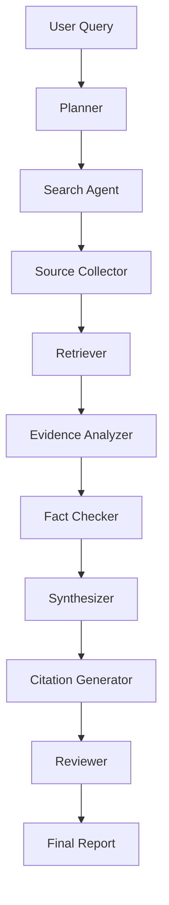

# Part XLVI — Research Agents

## Before you start

**What you need already:** [Part XXX](part30-planning.md) (planning with replanning), [Part XVII](part17-advanced-rag.md) (multi-hop decomposition, corrective RAG), [Part XLV](part45-browser-agents.md) (browser tools), [Part XXXI](part31-reasoning.md) (tool-assisted verification).

**What this part gives you:** Not a new mechanism — a genuine integration of nearly everything you've built into one coherent pipeline, plus one new, specific idea: a fact-checking stage that's structurally distinct from generation, catching a failure mode neither retrieval quality nor prompt wording alone can fix.

**Time:** 2–3 days.

**When you finish, you'll be able to:** Build a multi-stage research pipeline where each stage's output is verified before the next stage trusts it, rather than one long chain of hope.

---

## Stage 1 — The pipeline, and why each stage exists



Every one of these boxes is something you've already built, in some form, in an earlier part. The value of this part isn't any single box — it's understanding *why each one exists as a separate stage*, rather than one long prompt asking a model to "research this and write a report."

| Stage | What it does | You built this in |
|---|---|---|
| Planner | Decomposes the query into sub-questions | [Part XXX](part30-planning.md) |
| Search / Source Collector | Finds candidate sources | [Part XLV](part45-browser-agents.md) |
| Retriever | Pulls relevant passages from found sources | [Part XI](part11-rag-fundamentals.md) |
| Evidence Analyzer | Extracts specific claims from raw text | [Part XLIII Stage 4](part43-knowledge-graphs.md)'s triple extraction, generalized |
| Fact Checker | Verifies each claim against an independent source | New to this part — Stage 3 below |
| Synthesizer | Combines verified evidence into an answer | [Part XI](part11-rag-fundamentals.md) |
| Reviewer | A final quality gate before the report ships | [Part VIII Stage 6](part08-agent-architectures.md) |

**Check yourself before Stage 2:** For any three stages in this table, explain in one sentence why doing that stage separately (rather than folding it into one big prompt) produces a more reliable result.

---

## Stage 2 — Why a single "research and write" prompt isn't enough

Try, mentally, the alternative: one prompt saying "research this topic and write a report with citations." What goes wrong, specifically?

The model has no actual verification mechanism inside a single generation pass — it's the same limitation from [Part III](part03-llm-fundamentals.md) and [Part VIII](part08-agent-architectures.md): a single pass can *state* that a claim is verified, but stating something and it being true aren't the same thing, and there's no external check happening anywhere in that one call. A multi-stage pipeline, by contrast, can insert a genuine, separate verification step between "here's a claim" and "here's the final report" — exactly the difference between reflection (Part VIII) and tool-assisted verification (Part XXXI), now applied at the scale of a whole research report instead of one arithmetic claim.

**Check yourself before Stage 3:** Why can't a single, unstructured "research and write a report" prompt provide the same verification guarantee as a pipeline with a distinct fact-checking stage?

---

## Stage 3 — The new piece: fact-checking as a distinct, adversarial stage

```python
from dataclasses import dataclass, field


@dataclass
class Evidence:
    claim: str
    source_url: str
    confidence: float


async def fact_check(evidence: list[Evidence], verify_fn) -> list[Evidence]:
    """Cross-check each claim against an INDEPENDENT source before trusting
    it enough to synthesize into the final report. This is structurally the
    same idea as Part XVIII's faithfulness check, but applied to claims
    gathered from MULTIPLE sources, not one retrieval pass."""
    verified = []
    for e in evidence:
        is_supported = await verify_fn(e.claim, e.source_url)
        if is_supported:
            verified.append(e)
        else:
            print(f"DROPPED unverified claim: {e.claim!r} from {e.source_url}")
    return verified
```

The genuinely new idea here, beyond what you've built before: this stage isn't checking "does this claim match its own cited source" (that's Part XVIII's faithfulness check, and it's necessary but not sufficient here). It's checking each claim against evidence gathered from a *different, independent* source where possible — because a claim can be faithfully reproduced from a source that was itself wrong, or the model can have misattributed which source actually supports it. Independent cross-referencing catches errors a single-source faithfulness check structurally cannot.

**Check yourself before Stage 4:** Why is checking a claim against an *independent* source a stronger guarantee than checking it against the single source it was originally extracted from?

---

## Stage 4 — Assembling the full pipeline

```python
@dataclass
class ResearchReport:
    query: str
    findings: list[Evidence] = field(default_factory=list)
    summary: str = ""
    citations: list[str] = field(default_factory=list)
    review_notes: list[str] = field(default_factory=list)


async def run_research_pipeline(query: str, plan_fn, search_fn, verify_fn, synthesize_fn, review_fn) -> ResearchReport:
    sub_queries = await plan_fn(query)                      # Part XXX
    all_evidence: list[Evidence] = []
    for sq in sub_queries:
        sources = await search_fn(sq)                        # Part XLV
        all_evidence.extend(sources)

    verified_evidence = await fact_check(all_evidence, verify_fn)   # this part, Stage 3

    report = ResearchReport(
        query=query,
        findings=verified_evidence,
        summary=await synthesize_fn(query, verified_evidence),       # Part XI
        citations=sorted({e.source_url for e in verified_evidence}),
    )

    approved, notes = await review_fn(report)                # Part VIII Stage 6
    report.review_notes = notes
    if not approved:
        print(f"report rejected by reviewer: {notes}")
    return report
```

Trace through this once, end to end: every function argument (`plan_fn`, `search_fn`, `verify_fn`, `synthesize_fn`, `review_fn`) is something you've built the underlying mechanism for in an earlier part. This function's real content is the *sequencing and verification gating* between them — the discipline of not letting unverified evidence reach synthesis, and not letting an unreviewed report reach the user, rather than any single novel mechanism.

**Check yourself before the project:** If `fact_check` were removed from this pipeline entirely, what specific failure mode would become possible that wasn't before?

---

## Stage 5 — The honest cost, and why bounding matters more here than almost anywhere else

Multiply it out: multiple sub-queries, each triggering a search and retrieval pass, each producing several claims, each claim individually fact-checked against an independent source, then synthesis, then review. This is genuinely one of the most expensive architectures in this entire curriculum — every stage is at least one LLM call, and several stages fan out across multiple sub-queries and multiple claims.

This makes the cost and step-bounding discipline from [Part XXVIII](part28-agent-harness.md) not optional here — it's essential. A research pipeline with no bound on sub-query count, evidence count, or total cost can spiral to a genuinely large bill on a single ambitious question, in a way a simple single-pass RAG query never could.

**Check yourself before the project:** Why does a multi-stage research pipeline specifically need tighter, more deliberate cost bounding than a single-pass RAG query, even though both are "just" answering a question?

---

# The Project: A Bounded, Fact-Checked Research Pipeline

## What you're building

The full pipeline from Stage 4, with real cost/step tracking throughout, tested on real research questions — with the fact-checking stage demonstrably catching at least one real case where it prevented an unverified claim from reaching the final report.

```bash
$ python research_agent.py "What are the main approaches to reducing LLM hallucination?"
```

```
[plan] 3 sub-questions generated
[search] sub-question 1: 4 candidate sources found
[search] sub-question 2: 3 candidate sources found
[search] sub-question 3: 5 candidate sources found
[fact-check] 9/12 claims verified against independent sources
             3 claims DROPPED (could not be independently corroborated)
[synthesize] report generated from 9 verified claims
[review] APPROVED — citations present, evidence base sufficient

Total cost: $0.34   Total time: 18.2s   LLM calls: 23

REPORT: [full synthesized answer with citations]
```

## Why this project

This is the most integrated single agent in this curriculum's core sequence, and it's a genuine test of whether you can compose many previously-built pieces correctly, with the right verification gates between them — the real skill this whole curriculum has been building toward.

## Build it in stages

---

### Stage A — Wire in real planning and search

**Goal:** `plan_fn` and `search_fn`, using your real Part XXX planner and Part XLV browser agent (or a search API if you have one available).

**Do:**
1. Implement both against real components
2. Run them on a real research question, confirm sub-queries and candidate sources are sensible

**You're done when:** A real question produces a reasonable set of sub-questions and real candidate sources for each.

---

### Stage B — Real evidence extraction and fact-checking

**Goal:** `verify_fn`, genuinely cross-referencing claims against independent sources.

**Do:**
1. Extract specific claims from your Stage A sources (reuse Part XLIII's extraction-style prompt, generalized beyond triples to free-text claims)
2. Implement `fact_check`, attempting to verify each claim against a *different* source than the one it came from, where multiple sources exist
3. Run it on real evidence, confirm you get real drops — cases where a claim couldn't be independently corroborated

**You're done when:** You have at least one real example of `fact_check` correctly dropping an unverifiable claim, with a clear explanation of why it was dropped.

---

### Stage C — Synthesis and review, with full cost tracking

**Goal:** The complete pipeline, with cost and step tracking (reusing Part XXVIII's `CostController`) applied across every stage.

**Do:**
1. Implement `synthesize_fn` and `review_fn`
2. Wire cost tracking around every stage's LLM calls
3. Run the full pipeline on 3 different real research questions, recording total cost and time for each

**You're done when:** You have real cost/time numbers for 3 complete research pipeline runs, and can point to exactly where the cost went (which stage consumed the most).

---

### Stage D — Bound it, and prove the bound actually holds

**Goal:** A hard ceiling on sub-queries, evidence count, and total cost, tested against a deliberately ambitious question likely to try to exceed it.

**Do:**
1. Add explicit caps (max sub-queries, max evidence items, max total cost) enforced via `CostController`
2. Ask a deliberately very broad, ambitious question
3. Confirm the pipeline respects its bounds and produces an honest, possibly incomplete report rather than spiraling in cost

**You're done when:** You've watched a genuinely ambitious question get handled within bounds, with an honest report about what was and wasn't covered given the constraints, rather than an unbounded cost spiral.

---

## Common mistakes on this project

| Symptom | Cause | Fix |
|---|---|---|
| Fact-checking never drops anything, even on deliberately dubious claims | `verify_fn` too lenient, or actually checking against the *same* source the claim came from rather than an independent one | Confirm the verification logic genuinely seeks an independent source, not just re-reading the original |
| Total cost is far higher than expected | No cap on sub-query count or evidence count, letting the pipeline fan out unboundedly | Add explicit caps at every stage that could fan out, not just an overall budget check at the end |
| Final report cites a source that doesn't actually support its claim | Evidence extraction or fact-checking bug — trace which stage let an unverified or misattributed claim through | Add a Part XVIII-style faithfulness check specifically on the synthesis step's output as an additional gate |

## Going further (optional)

1. **A configurable rigor level** — a "quick answer" mode skipping fact-checking for low-stakes questions, versus a "deeply verified" mode using this part's full pipeline, chosen based on the question's apparent importance.
2. **Parallelize independent sub-question research** using Part XXVI's fan-out — sub-questions that don't depend on each other's results can be researched concurrently rather than sequentially.
3. **A real evaluation of the whole pipeline** using Part XXXVIII's trajectory evaluation, checking not just the final report's quality but whether the pipeline's stages were used sensibly for a range of test questions.

---

## Checkpoint

**Knowledge:**
1. Why can't a single "research and write" prompt provide the same verification guarantee as a multi-stage pipeline?
2. Why is checking a claim against an independent source stronger than checking it against its original source?
3. Why does a research pipeline need tighter cost bounding than a single-pass RAG query?

**Implementation:** Build the full pipeline — plan, search, fact-check, synthesize, review — with cost tracking, from memory.

**Debugging:** A research report cites a source that doesn't actually support its claim. Trace which pipeline stage's failure this most likely indicates, and how you'd confirm it.

**Architecture:** Design cost/step budgets for each individual pipeline stage (not just an overall total) for a research agent expected to handle complex, multi-part questions within a fixed dollar budget per report.

---

**Next:** [Part XLVII — Production Architecture](part47-production-architecture.md), where you'll assemble everything into a deployable service architecture — the gateway, auth, and infrastructure layer around the agents you've been building.
