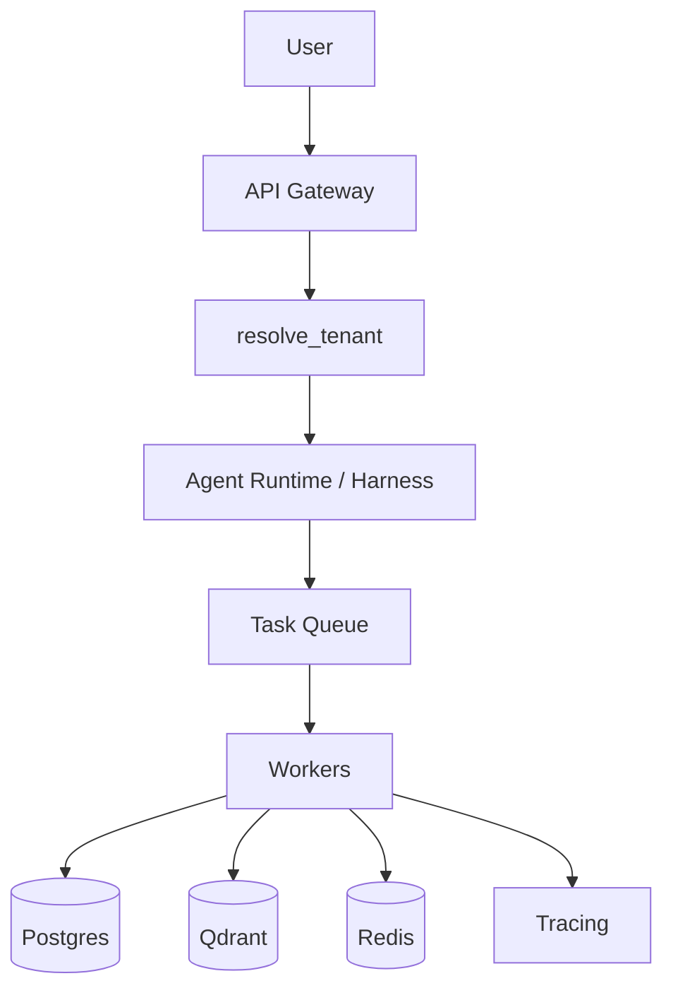

# Part XLVII — Production Architecture

## Before you start

**What you need already:** [Part XLII](part42-databases-for-agents.md) (the data layer), [Part XXVIII](part28-agent-harness.md) (the agent harness), [Part XXXV](part35-security.md) (permission scoping). This part is about the layer that sits *in front of* everything you've built — how real requests actually reach your agents safely.

**What this part gives you:** A concrete architecture connecting a user's request all the way through to a running agent, with the one detail that determines whether your security model actually holds: where permissions get decided, and why it can't be where you'd naively put them.

**Time:** 2 days.

**When you finish, you'll be able to:** Design and build the boundary between "an untrusted request arrives" and "an authorized, bounded agent run begins" — correctly, not just functionally.

---

## Stage 1 — The one mistake that undoes every security mechanism you've built

Here's a trap worth seeing clearly before building anything: imagine an API endpoint that accepts a request body like `{"tenant_id": "acme", "tool": "search", "goal": "..."}`. If your code trusts `tenant_id` from that request body to decide which tenant's data and permissions apply, you've built something that looks secure but isn't — because **anything read directly from a client-supplied request is, by definition, something the client controls.** A malicious or simply buggy client could send `{"tenant_id": "someone_elses_tenant", ...}` and, if your code trusts it, gain access to data and permissions that were never meant to be theirs.

This directly undoes [Part XXXV](part35-security.md)'s entire discipline — you can have perfect tool-scoping logic downstream, but if the *input* to that logic (which tenant, what permissions) is itself attacker-controlled, the scoping is enforcing the attacker's own claims about themselves.

**Check yourself before Stage 2:** Why does trusting a client-supplied `tenant_id` field undo tool-scoping logic that's otherwise correctly implemented?

---

## Stage 2 — The fix: resolve identity server-side, from something the client can't forge

```python
from dataclasses import dataclass
from fastapi import FastAPI, HTTPException, Depends, Header

app = FastAPI()


@dataclass
class TenantContext:
    tenant_id: str
    allowed_tools: set[str]
    cost_budget_usd: float


TENANT_STORE = {
    "demo-key-abc123": TenantContext(tenant_id="acme", allowed_tools={"search", "calculator"}, cost_budget_usd=1.0),
}


async def resolve_tenant(x_api_key: str = Header(...)) -> TenantContext:
    # The API key is the thing the client actually presents. Everything about
    # WHO they are and WHAT they're allowed to do is looked up SERVER-SIDE
    # from that key — never trusted from anything else in the request.
    tenant = TENANT_STORE.get(x_api_key)
    if tenant is None:
        raise HTTPException(status_code=401, detail="invalid API key")
    return tenant
```

The crucial shift: the client presents a credential (`x_api_key`) — something that can be verified, revoked, and is specific to them. Everything downstream (`tenant_id`, `allowed_tools`, `cost_budget_usd`) is *looked up* from that credential, server-side, in a store the client has no access to modify. The client never gets to simply *assert* who they are or what they're allowed to do; they present a credential, and your server decides the rest.

```python
@app.post("/agent/run")
async def run_agent_endpoint(payload: dict, tenant: TenantContext = Depends(resolve_tenant)):
    requested_tool = payload.get("tool")
    if requested_tool and requested_tool not in tenant.allowed_tools:
        raise HTTPException(status_code=403, detail=f"tool not permitted: {requested_tool}")

    task_id = await enqueue_agent_run(tenant.tenant_id, payload)
    return {"task_id": task_id, "status": "queued"}
```

Notice `tenant.allowed_tools` — resolved server-side from `resolve_tenant` — gates the request, not anything the client's `payload` claims about itself. This is [Part XXXV](part35-security.md)'s core principle, applied at the API boundary: **permission is decided by your code, from something the client can't forge, before the agent ever runs.**

**Check yourself before Stage 3:** If `run_agent_endpoint` instead read `payload.get("allowed_tools")` directly from the client's request body, what would immediately go wrong?

---

## Stage 3 — Why the endpoint enqueues instead of running the agent directly

Look again at `run_agent_endpoint` — it calls `enqueue_agent_run` and returns immediately with a `task_id`, rather than running the agent synchronously within the HTTP request and returning its final answer. This is deliberate, and it connects to something you already know from [Part VII](part07-what-is-an-agent.md): an agent's total runtime is genuinely unpredictable — it could finish in 2 seconds or, for a complex multi-step task, take much longer.

An HTTP request that blocks for an unpredictable, potentially long duration is a bad design — it ties up server resources, risks gateway timeouts, and gives no way to recover if the connection drops mid-run (a genuinely different problem than the crash-and-resume you solved in Part IX, since here it's the *client's* connection, not your server process, that's at risk of dropping). Enqueueing and returning a `task_id` immediately means the actual agent run happens asynchronously, in a worker process, with the client polling or subscribing for the result — decoupling "how long the agent takes" from "how long the client's HTTP connection needs to stay open."

**Check yourself before Stage 4:** Why is synchronously running a potentially long agent task inside an HTTP request handler a worse design than enqueueing it and returning immediately?

---

## Stage 4 — The full picture



Every box here is something you've built: `resolve_tenant` is Stage 2's server-side identity resolution. The Task Queue and Workers are what Part XLIX formalizes fully (you'll build the real version there). Postgres, Qdrant, and Redis are Part XLII's data layer. Tracing is Part XXXIX. The point of this diagram isn't its novelty — it's that you can now trace, concretely, exactly what happens to a real request from arrival to a running, bounded, authorized agent.

**Check yourself before the project:** Walk through this diagram for a single request, naming which earlier Part's mechanism handles each step.

---

# The Project: A Real Gateway-to-Agent Path

## What you're building

A working FastAPI service implementing Stage 2's identity resolution, wired to a real Redis-backed queue and a worker that runs your Part XXVIII harness — with server-side permission enforcement proven, not just implemented.

```bash
$ curl -H "X-API-Key: demo-key-abc123" -d '{"tool": "search", "goal": "..."}' localhost:8000/agent/run
```

```json
{"task_id": "a1b2c3d4", "status": "queued"}
```

```bash
$ curl -H "X-API-Key: demo-key-abc123" -d '{"tool": "send_email", "goal": "..."}' localhost:8000/agent/run
```

```json
{"detail": "tool not permitted: send_email"}
```

## Why this project

This is the actual boundary your entire agent system sits behind in a real deployment — get the identity/permission resolution wrong here and every downstream security mechanism you built is undermined, regardless of how carefully it was implemented.

## Build it in stages

---

### Stage A — Server-side identity resolution

**Goal:** `resolve_tenant`, backed by a real Postgres table instead of the in-memory dict shown here.

**Do:**
1. Create a real `tenants` table with API key, tenant ID, allowed tools, and cost budget
2. Implement `resolve_tenant` querying it
3. Test with a valid key (succeeds) and an invalid key (401, rejected)

**You're done when:** Identity resolution works against real, persisted tenant data.

---

### Stage B — Server-side permission enforcement, adversarially tested

**Goal:** Prove, not just implement, that client-supplied fields can't bypass permission checks.

**Do:**
1. Implement the tool-permission check in `run_agent_endpoint`
2. Attempt the exact attack from Stage 1 — send a request with a client-supplied field trying to claim different permissions or a different tenant than what the API key actually resolves to
3. Confirm the attack fails, because the check is based entirely on server-resolved `tenant.allowed_tools`, never on anything from the request body

**You're done when:** You've personally attempted to spoof permissions via the request body and watched it fail.

---

### Stage C — Enqueue and worker, wired to your Part XXVIII harness

**Goal:** The endpoint enqueues via Redis, a separate worker process dequeues and actually runs the agent through your harness.

**Do:**
1. Implement `enqueue_agent_run` using Redis (reuse Part XLIX's patterns if you've previewed them, or a simple Redis list for now)
2. Build a worker script that dequeues tasks and runs them through your Part XXVIII harness, using the resolved tenant's `allowed_tools` and `cost_budget_usd`
3. Confirm a queued request actually gets processed by the worker, with results retrievable by `task_id`

**You're done when:** A real end-to-end request — API call, queue, worker execution, result retrieval — works correctly.

---

### Stage D — Confirm budget enforcement flows through correctly

**Goal:** A tenant's `cost_budget_usd`, resolved at the gateway, actually constrains their agent run in the worker.

**Do:**
1. Set a very low `cost_budget_usd` for a test tenant
2. Give them a task likely to exceed it
3. Confirm the agent run stops with a budget-exceeded error, using the exact budget resolved server-side for that tenant — not a value the client could have influenced

**You're done when:** You've confirmed the budget enforced in the worker traces back entirely to server-resolved tenant data, with no client-controlled path to override it.

---

## Common mistakes on this project

| Symptom | Cause | Fix |
|---|---|---|
| A client can access another tenant's data by modifying request fields | Some code path still reads tenant/permission info from the request body instead of exclusively from `resolve_tenant`'s output | Audit every place tenant/permission data is used and confirm it traces back only to the resolved `TenantContext` |
| Requests hang waiting for the agent to finish | Endpoint running the agent synchronously instead of enqueueing | Confirm `run_agent_endpoint` returns immediately after enqueueing, never awaiting the actual agent run |
| Worker uses the wrong tenant's budget/permissions | Task payload doesn't carry the resolved tenant context through to the worker correctly | Ensure the *resolved* `TenantContext` (not just a raw tenant ID string) is what gets passed to the worker, or is re-resolved server-side by the worker itself |

## Going further (optional)

1. **Rate limiting per tenant**, reusing Part XXIV's `RateLimiter`, applied at the gateway before a request even reaches the queue.
2. **A health check endpoint** for the gateway and workers, feeding into the readiness/liveness probes you'll build properly in [Part XLVIII](part48-deployment.md).
3. **Multiple tenant tiers** (free vs. paid) with genuinely different `allowed_tools` and `cost_budget_usd`, confirmed to be correctly enforced for both.

---

## Checkpoint

**Knowledge:**
1. Why does trusting a client-supplied `tenant_id` undo correctly-implemented tool-scoping logic?
2. Why does the gateway enqueue rather than run the agent synchronously?
3. Trace, from memory, which earlier Part's mechanism corresponds to each box in this part's architecture diagram.

**Implementation:** Build `resolve_tenant` and the permission-checking endpoint, backed by real persisted data, from memory.

**Debugging:** A tenant reports they were somehow able to use a tool outside their allowed set. Trace, step by step, exactly where in this architecture the enforcement gap would most likely be.

**Architecture:** Design the migration path from this part's single-gateway architecture to a multi-region deployment, without any window where permission enforcement could be bypassed during the transition.

---

**Next:** [Part XLVIII — Deployment](part48-deployment.md), where this architecture gets containerized, health-checked, and deployed with zero-downtime rolling updates.
