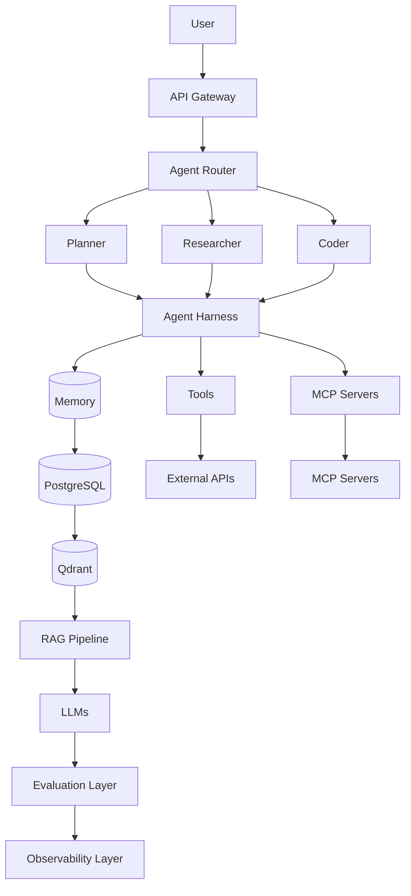

# Part LXX — Final Expert Project: Production Agent Operating System

## What this page is for, in plain terms

Everything in this curriculum has been building toward one thing: proving you can design and build a real, complete agent platform, not just individual pieces of one. This isn't a project you'll finish in a weekend — treat it the way the capstones in Part LIV asked you to (fill out the [Project Requirement Format](part55-project-requirement-format.md) first, genuinely, before writing code), and expect it to take real, sustained effort across weeks, not a single sprint.

**Why this is different from a capstone, concretely:** Capstone 1 asked you to build a production RAG platform — one coherent subsystem. This project asks you to build the thing that *contains* several subsystems like that, wired together with routing, shared memory, shared observability, and one unified security and cost-control layer — the "operating system" framing is deliberate, because you're building the substrate other agents would run on top of, not just one more agent. If you complete this and can defend every architectural decision under the scrutiny of Part LXV's system-design questions, that's the concrete, demonstrable signal — not a feeling of "I've read the whole curriculum" — that you've actually reached the level this curriculum set out to build.

## 1. Objective
Design and implement a complete Agent Platform integrating nearly every mechanism built across this curriculum into one coherent, operable system.

## 2. Architecture

## 3. Required Components and Their Source Parts

| Component | Requirement | Source Part |
|---|---|---|
| LLM routing | Cost-aware, multi-provider, with fallback | [IV](part04-llm-application-engineering.md), [XL](part40-cost-optimization.md) |
| Prompt management | Versioned, regression-tested | [V](part05-prompt-engineering.md) |
| Structured output | Schema-validated at every boundary | [VI](part06-structured-outputs-tool-calling.md) |
| Tool calling | Contract-based, idempotency-aware | [VI](part06-structured-outputs-tool-calling.md), [XXXIII](part33-tool-engineering.md) |
| RAG | Hybrid retrieval, reranking, citations | [XI](part11-rag-fundamentals.md)–[XVIII] |
| Qdrant | Production-tuned, sharded/replicated | [XV](part15-vector-databases.md)/[XVI](part16-qdrant-deep-dive.md) |
| Memory | Multi-tenant isolated, decay/consolidation | [X](part10-memory.md) |
| LangChain/LangGraph/CrewAI | At least one used deliberately where its abstraction fits | [XIX](part19-langchain.md)–[XXII] |
| MCP + MCP servers | At least 3 servers, trust-tiered | [XXIII](part23-mcp.md)–[XXV] |
| Multi-agent orchestration | Supervisor + specialized workers | [XXVI](part26-agent-orchestration.md)/[XXVII](part27-multi-agent-systems.md) |
| Human-in-the-loop | Durable, risk-based approval gates | [XXXIV](part34-human-in-the-loop.md) |
| State management + persistence | Atomic, versioned checkpoints | [IX](part09-agent-state.md) |
| Checkpointing + retries | Crash-safe, idempotent resume | [IX](part09-agent-state.md)/[XXXVI](part36-reliability.md) |
| Security | Defense-in-depth against injection, least privilege | [XXXV](part35-security.md) |
| Sandboxing | Isolated execution for code/high-risk tools | [XXIV](part24-mcp-server-development.md)/[XLIV](part44-code-agents.md) |
| Evaluation | Trajectory + groundedness + calibrated judge, CI-gated | [XVIII](part18-rag-evaluation.md)/[XXXVIII](part38-agent-evaluation.md) |
| Observability | Full tracing, redacted logs, percentile metrics | [XXXIX](part39-observability.md) |
| Cost tracking | Per-request/session/tenant budgets enforced in code | [XL](part40-cost-optimization.md) |
| Performance monitoring | p50/p95/p99 dashboards, parallelized tool calls | [XLI](part41-performance-engineering.md) |
| Distributed execution | Queue-backed, idempotent, horizontally scaled workers | [XLIX](part49-distributed-agents.md) |

## 4. Explain How Every Component Connects
Before writing code, produce a written architecture document (using the [Project Requirement Format](part55-project-requirement-format.md)) that traces, for a single example user request, the *exact* path through every layer in the diagram above — including what happens at each of the following decision points:
- How does the Agent Router decide between Planner/Researcher/Coder?
- How does the Harness enforce tool permissions and cost budgets uniformly across all three agent types?
- How does Memory get scoped per user/tenant, and how does it interact with the RAG pipeline's retrieval?
- How does a crash mid-run get detected and recovered, at which layer?
- How does the Evaluation Layer gate a prompt or routing change from reaching production?
- How does the Observability Layer trace a single request across the Router, Harness, Memory, Tools, and MCP layers with one correlation ID?

## 5. Implementation Staging (Mandatory Order)
1. **Beginner**: Single agent type (Researcher only), mocked externals, no distribution, in-memory state — verify the harness and RAG pipeline work end-to-end.
2. **Intermediate**: All three agent types with real Supervisor routing, real Postgres/Qdrant/Redis, basic reliability (retries, timeouts) — verify multi-agent coordination.
3. **Advanced**: Full security (injection defenses, permission scoping), full observability (tracing dashboard), evaluation gate in CI, human-approval gate for high-risk actions — verify against the [Production Readiness Checklist](part68-production-readiness-checklist.md) in full.
4. **Distributed**: Queue-backed workers, horizontal scaling, chaos-tested crash recovery — verify against [Part XLIX](part49-distributed-agents.md)'s idempotency/delivery-semantics discipline.

## 6. Final Verification
Before considering this project complete:
- [ ] Every item in the [Production Readiness Checklist](part68-production-readiness-checklist.md) is either checked or has a documented, conscious risk-acceptance decision.
- [ ] The system passes a chaos test (kill a worker mid-task) with zero duplicated side effects and zero lost work.
- [ ] The system passes an adversarial test suite covering direct and indirect prompt injection across all three agent types.
- [ ] A full trace for one representative request is reviewable end-to-end in the observability layer, correlating Router → Harness → Memory/RAG → Tools/MCP → Evaluation.
- [ ] Cost per request is measured and within a documented budget, with the budget enforced in code, not just monitored.
- [ ] You can answer every Expert Checkpoint question (Knowledge/Implementation/Debugging/Architecture) from every Part listed in §3 using *this specific system* as your concrete reference, not the curriculum's generic examples.

## 7. What Completing This Project Means
This is the terminal exercise of the curriculum: a learner who can design, build, secure, evaluate, deploy, and operate this system — and defend every architectural decision under the scrutiny of [Part LXV](part65-expert-system-design-questions.md)'s system-design questions and [Part LXIX](part69-expert-final-examination.md)'s examination — has progressed from **Agent Engineer** through **Agent Architect** and **Agent Platform Engineer** to **Agentic AI Systems Expert**, per this curriculum's stated goal: understanding *why* these systems work, not merely how to call framework APIs.
