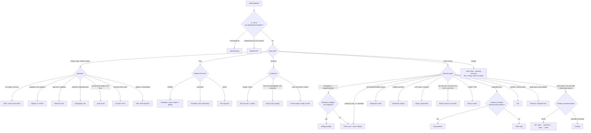

# Part 22 — Instinct Training

Chapters teach techniques with the topic label attached. Interviews never give the label. This part trains the missing skill: **recognition under uncertainty**.

**How to use the mixed sets:** for each problem, write down within 2 minutes (1) the technique, (2) the *signal* that pointed to it, and (3) the target complexity. Then open the answers. Score yourself. Re-do the sets you scored < 12/15 a week later.

---

## 22.1 Mixed Unlabeled Problem Sets

### Set A
1. Given daily stock prices, find the maximum profit from one buy followed by one later sell.
2. Given a string (n ≤ 1000), find its longest palindromic substring.
3. Given a 0/1 grid, return each cell's distance to the nearest 0.
4. Given meeting times, can one person attend all of them?
5. Given an integer array with negatives, find the maximum sum of a contiguous subarray.
6. Given a rotated sorted array of distinct values, find the minimum in O(log n).
7. Given a list of words sorted by an unknown alphabet, derive the letter order.
8. Given an array and k, return the k most frequent elements, better than O(n log n).
9. Given a binary tree, return the values visible from the right side.
10. Given coin denominations and an amount, count the combinations that make the amount.
11. Rotate an n×n matrix 90° clockwise in place.
12. Return all unique quadruplets that sum to a target.
13. Can string s be segmented into dictionary words?
14. Given intervals, find the minimum number to remove so the rest don't overlap.
15. Given 10⁵ points, return the k closest to the origin.

Answers — Set A

| # | Technique | Key insight / signal |
|---|---|---|
| 1 | One pass, running min | Best sell today = price − min so far (a tiny DP/greedy) |
| 2 | Expand around the center | 2n−1 centers × O(n) expansion; O(n²) is fine for n ≤ 1000 |
| 3 | Multi-source BFS | Seed all 0s at distance 0; BFS layers = distances |
| 4 | Sort + adjacent check | After sorting by start, only neighbors can overlap |
| 5 | Kadane (1D DP) | A negative running sum never helps a future subarray → reset |
| 6 | Binary search (compare with hi) | `nums[mid] > nums[hi]` ⇒ the drop is to the right |
| 7 | Topological sort | The first differing char of adjacent words gives an edge; watch the prefix-invalid case |
| 8 | Counter + bucket sort (or heap) | Frequencies ≤ n → buckets give O(n) |
| 9 | BFS by levels | Take the last node of each level |
| 10 | Unbounded knapsack count | Coins outer loop ⇒ combinations, not permutations |
| 11 | Transpose + reverse each row | Rotation = two simple in-place reflections |
| 12 | Sort + fix two + two pointers | k-Sum reduction; skip duplicates at each level |
| 13 | 1D DP over prefixes | `dp[i] = any(dp[j] and s[j:i] in words)` |
| 14 | Greedy, sort by end | Keep the max compatible set (activity selection); remove the rest |
| 15 | Heap of size k / quickselect | Top-k: O(n log k) or O(n) average |

### Set B
1. Determine whether a singly linked list is a palindrome using O(1) extra space.
2. Given bar heights, compute the trapped rain water.
3. A string contains `(`, `)`, and `*`, where `*` can be `(`, `)`, or empty. Is it valid?
4. An array of n integers in [1..n] has some values appearing twice. Return them in O(1) extra space.
5. Given package weights in order and D days, find the minimum ship capacity.
6. Min-cost path from the top-left to the bottom-right of a cost grid, moving only right or down.
7. The same, but you can move in all 4 directions (non-negative costs).
8. Length of the longest strictly increasing subsequence, n ≤ 10⁵.
9. Tasks with a cooldown of n between identical tasks: minimum total time.
10. Given n nodes and an undirected edge list, is it a valid tree?
11. Count subarrays of positive integers whose product is less than k.
12. Search for a target in a matrix whose rows and columns are both sorted.
13. Evaluate an expression string with `+`, `−`, parentheses, and non-negative integers.
14. Minimum insert/delete/replace operations to turn word1 into word2.
15. Given a letter board and 10⁴ words, return all words present in the board.

Answers — Set B

| # | Technique | Key insight / signal |
|---|---|---|
| 1 | Fast/slow + reverse the second half | O(1) space rules out a stack/copy |
| 2 | Two pointers (or prefix/suffix max) | Water at i = min(maxL, maxR) − h; resolve the smaller side |
| 3 | Greedy range of open counts | Track [lo, hi] possible open counts; valid if lo reaches 0 and hi never < 0 |
| 4 | Index-as-hash (sign marking) | Values in [1..n] → flip the sign at index v−1; a second visit sees negative |
| 5 | Binary search on answer + greedy check | "Minimum capacity such that…" is monotone |
| 6 | Grid DP | Right/down only ⇒ DAG ⇒ row-major DP |
| 7 | Dijkstra | 4 directions create cycles; DP order no longer exists |
| 8 | LIS with patience sorting | n = 10⁵ rules out O(n²); tails + bisect |
| 9 | Greedy counting formula (or heap sim) | `max(len, (maxf−1)(n+1) + count_of_maxf)` |
| 10 | Union-Find (or DFS) | Tree ⇔ exactly n−1 edges and no cycle (all unions succeed) |
| 11 | Sliding window (counting) | Positive values ⇒ the product is monotone; add `r − l + 1` |
| 12 | Staircase elimination from the top-right | Each comparison eliminates a row or a column: O(m + n) |
| 13 | Stack | Save (result, sign) on `(`, restore on `)` |
| 14 | 2D DP (edit distance) | Last characters: match, or 1 + min(insert, delete, replace) |
| 15 | Trie + backtracking | Many words on one grid; prune paths that aren't prefixes |

### Set C
1. n ≤ 15 workers and n jobs with a cost matrix: minimum total cost of a one-to-one assignment.
2. For each window of size k, return the median.
3. Minimum number of deletions to make a string a palindrome.
4. For each element of a circular array, find the next greater element.
5. Cheapest flight route from A to B using at most k stops.
6. Does an array contain a subarray of length ≥ 2 whose sum is a multiple of k?
7. On an 'X'/'O' board, capture all 'O' regions not connected to the border.
8. Report the median after each number in a stream.
9. Find the longest common prefix among an array of strings.
10. Minimum number of jumps to reach the end, given the max jump length at each index.
11. Count inversions in an array of 10⁵ integers.
12. In a directed graph with success probabilities on the edges, find the most reliable path.
13. Length of the longest valid (well-formed) parentheses substring.
14. Return all permutations of distinct integers.
15. Design a hit counter returning the number of hits in the past 300 seconds (timestamps non-decreasing).

Answers — Set C

| # | Technique | Key insight / signal |
|---|---|---|
| 1 | Bitmask DP | n ≤ 15 ⇒ dp[mask] = min cost assigning the first popcount(mask) workers to the jobs in mask |
| 2 | Two heaps + lazy deletion (or a sorted list) | A median needs both halves; windows need removal |
| 3 | Interval DP / LPS | Answer = n − longest palindromic subsequence (= LCS(s, reverse(s))) |
| 4 | Monotonic stack over 2n | Circular ⇒ iterate twice with `i % n` |
| 5 | Bellman-Ford with k+1 rounds | A hop limit breaks Dijkstra's settle-once property |
| 6 | Prefix sum mod k + first index | Equal remainders at distance ≥ 2 |
| 7 | DFS/BFS from the border (complement) | Mark safe 'O's first; flip the rest |
| 8 | Two heaps | Max-heap low half, min-heap high half, balanced sizes |
| 9 | Vertical scan (or trie) | Compare column by column until a mismatch |
| 10 | Greedy (implicit BFS levels) | Reachable indices per jump count form a window |
| 11 | Merge sort count / Fenwick tree | n = 10⁵ rules out O(n²); count during merge |
| 12 | Dijkstra on the product (max-heap) | Probabilities ≤ 1 multiply like non-negative weights (or use −log) |
| 13 | Stack of indices (or DP) | Keep the index of the last unmatched `)` as the base |
| 14 | Backtracking with used[] | Output is n!; enumerate |
| 15 | Deque of timestamps (sliding window over time) | Pop from the front while older than t − 300; or 300 circular buckets |

### Set D
1. Houses arranged in a circle, no two adjacent robbed: maximize the loot.
2. Accounts are lists of emails; merge accounts that share any email.
3. Length of the shortest substring containing every distinct character of the string.
4. Cars at positions with speeds drive to a target and can't pass; count the fleets that arrive.
5. Is n (up to 10¹²) a perfect square?
6. Given ≤ 300 points, the max number of points on one straight line.
7. Burst balloons (coins = product of the current neighbors) to maximize the total.
8. Graph with n ≤ 12 nodes: the shortest walk visiting every node (start anywhere, revisits allowed).
9. Sorted array: remove duplicates in place so each value appears at most twice.
10. Binary tree: the maximum path sum between any two nodes.
11. Array with negatives and k: length of the shortest subarray with sum ≥ k.
12. Count the distinct subsequences of s that equal t.
13. Given intervals and query points, count how many intervals cover each point.
14. Height grid: cells from which water can flow to both the Pacific (top/left) and the Atlantic (bottom/right).
15. Jobs with start, end, and profit: max profit from non-overlapping jobs.

Answers — Set D

| # | Technique | Key insight / signal |
|---|---|---|
| 1 | 1D DP twice | Circle ⇒ max(rob(nums[1:]), rob(nums[:-1])) |
| 2 | Union-Find | Shared email ⇒ equivalence; union through an email→owner map |
| 3 | Sliding window (shortest) | Need = number of distinct chars; shrink while valid |
| 4 | Sort by position desc + arrival times | Scan from the car nearest the target; a car whose arrival time exceeds the current fleet's time starts a new fleet (otherwise it merges) |
| 5 | Binary search / `math.isqrt` | n ≤ 10¹² ⇒ O(log n) |
| 6 | Hash map of GCD-normalized slopes per anchor | O(n²); no floats |
| 7 | Interval DP (last balloon) | "First burst" breaks independence; "last burst" splits cleanly |
| 8 | BFS over (node, visited mask) | n ≤ 12 ⇒ 2¹²·12 states; multi-source start |
| 9 | Read/write pointers | Keep x if `write < 2 or x != nums[write−2]` |
| 10 | Postorder, report a chain, record the bend | A node reports `val + max(l, r)`; records `val + l + r` |
| 11 | Prefix sums + monotonic deque | Negatives break the sliding window; keep increasing prefix candidates |
| 12 | 2D DP | `dp[i][j] = dp[i−1][j] + (s[i−1]==t[j−1]) · dp[i−1][j−1]` |
| 13 | Sort starts and ends + binary search | cover(q) = #starts ≤ q − #ends < q |
| 14 | Reverse BFS/DFS from each ocean | Search uphill from the borders; intersect the two sets |
| 15 | DP + binary search | Sort by end; dp = max(skip, profit + dp[last compatible]) |

---

## 22.2 "Looks Like X, Is Actually Y" Gallery

| # | Problem | Looks like | Actually | Distinguishing signal |
|---|---|---|---|---|
| 1 | Jump Game (LC 55) | DP over reachable indices | **Greedy furthest reach** | Only *whether* matters, and reachability is a prefix, so one number summarizes the state |
| 2 | Gas Station (LC 134) | O(n²) simulation from each start | **Greedy reset** | Failing at i rules out every start in between |
| 3 | Coin Change (LC 322) | Greedy (largest coin first) | **DP** | Arbitrary denominations; counterexample [1,3,4], 6 |
| 4 | House Robber (LC 198) | Greedy (take the biggest) | **DP** | A choice blocks neighbors; [2,3,2] breaks greedy |
| 5 | Subarray Sum Equals K (LC 560) | Sliding window | **Prefix sum + hash** | Negative numbers ⇒ the window sum isn't monotone |
| 6 | Split Array Largest Sum (LC 410) | Partition DP | **Binary search on answer + greedy** | "Minimize the maximum" ⇒ the feasibility check is monotone |
| 7 | Koko Eating Bananas (LC 875) | Math / greedy | **Binary search on answer** | "Minimum speed such that…" |
| 8 | Swim in Rising Water (LC 778) | Grid DP / BFS | **Minimax path: Dijkstra / UF / BS+BFS** | The cost is the max along the path, and 4-directional moves create cycles |
| 9 | Longest Consecutive Sequence (LC 128) | Sort then scan | **Hash set, start at run beginnings** | O(n) required; consecutive *values*, not positions |
| 10 | Find the Duplicate Number (LC 287) | Hashing / sorting | **Floyd's cycle detection** | Read-only + O(1) space + values in [1..n] |
| 11 | Kth Smallest in a Sorted Matrix (LC 378) | Heap k-way merge | **Binary search on value** (both work) | Counting ≤ x is O(n) per row-sorted matrix |
| 12 | Task Scheduler (LC 621) | Heap simulation | **Counting formula** | The most frequent task dictates the frame; idle slots are computable |
| 13 | Burst Balloons (LC 312) | Greedy / backtracking | **Interval DP** | Neighbors change as you go; fix the *last* burst |
| 14 | Trapping Rain Water (LC 42) | DP / stack | **Two pointers** (O(1) space) | Only the smaller side's max matters |
| 15 | Word Ladder (LC 127) | String DP / backtracking | **BFS** | "Minimum transformations", unit cost per step |
| 16 | Min-cost path, 4-directional moves | Grid DP | **Dijkstra** | Cycles ⇒ no valid DP order |
| 17 | Course Schedule (LC 207) | Backtracking / DP | **Topological sort / cycle detection** | Prerequisites ⇒ DAG check |
| 18 | Partition Labels (LC 763) | Interval merging / DP | **Greedy with last occurrence** | Each part must extend to the last occurrence of its letters |
| 19 | Russian Doll Envelopes (LC 354) | 2D DP O(n²) | **Sort + LIS O(n log n)** | Sort by width asc, height desc to forbid equal widths, then 1D LIS |
| 20 | Target Sum (LC 494) | Backtracking over signs | **0/1 knapsack count** | Count only; transform to subset sum P = (S+T)/2 |
| 21 | Top K Frequent Elements (LC 347) | Heap | **Bucket sort** (O(n)) | Frequencies are bounded by n |
| 22 | Maximal Rectangle (LC 85) | 2D DP | **Histogram + monotonic stack per row** | Fixing the bottom row reduces it to Largest Rectangle in Histogram |
| 23 | Minimum Window Substring (LC 76) | Two-string DP | **Sliding window** | Contiguous + shortest + "contains all" is monotone |
| 24 | Median of Two Sorted Arrays (LC 4) | Merge | **Binary search on the partition** | O(log(m+n)) required ⇒ discard half each step |

---

## 22.3 Decision Flowchart

Text version (if Mermaid doesn't render): **Input type → question type → constraints.**
1. Is the output exponential (all subsets/permutations)? → Backtracking.
2. Graph-like (states + moves)? → BFS (unit) / Dijkstra (weighted) / topo (order) / UF (connectivity) / MST (connect all).
3. Tree? → Postorder (from children) / preorder (from ancestors) / BFS (levels).
4. Intervals? → Sort by start (merge) / by end (select) / events (concurrency).
5. Array/string: contiguous → window or prefix sums; pairs → two pointers or hash; nearest dominance → monotonic stack; k-th → heap; minimax → binary search on answer; interacting choices → DP (unless greedy is provable).
6. Then check n against the constraint table and discard anything too slow.

---

## 22.4 When Stuck, Try This (ranked)

1. **Solve a tiny instance by hand (n = 3–5), slowly.** Watch what *your brain* does. You usually use the right algorithm intuitively ("I'd take the smallest first…").
2. **State the brute force and name the repeated work.** Ask: "what does the inner loop compute, and have I computed it before?" That points to a lever (§0.4).
3. **Sort the input.** Does order unlock two pointers, greedy, binary search, or neighbor-only interactions?
4. **Think about the answer's range.** If you can *check* a candidate answer quickly and the check is monotone → binary search on the answer.
5. **Fix one variable.** Fix the left end, the anchor element, the pair of rows, or the last element chosen. Does the rest become a known 1D problem?
6. **Reverse the problem.** Process from the end, reverse time (deletions → unions), search from the target, count the complement (total − bad), or think about the *last* operation instead of the first.
7. **Change the representation.** Graph of states, prefix sums, differences, bits, a canonical key, sorted events.
8. **Ask what information a decision needs.** If a greedy choice fails, the counterexample shows which extra state to remember → DP.
9. **Look at the constraints again.** n ≤ 20? Values ≤ 10⁴? k ≤ 100? Each is a hint.
10. **Ask the interviewer a narrowing question.** "Can I assume the input is sorted / values are bounded / there's exactly one answer?" Also: "Would an O(n log n) solution be acceptable?" That's a legitimate way to calibrate.

---

## 22.5 12-Week Study Plan

**Daily rhythm (1.5–2 h):** 1 new topic block (read the chapter, re-derive the worked examples), 2–3 new problems, 2–3 **spaced reviews**.

**Spaced repetition rule:** every problem you solve goes into a log (date, problem, technique, key insight in one line). Re-solve it **without looking** at +1, +3, +7, and +21 days. If you fail a review, reset its schedule to +1.

**The 30–40 minute rule:** if you can't solve a problem in 30–40 minutes, read **the approach, not the code**. Write the key insight in your log. The next day, re-implement it from scratch. Reading code gives you the illusion of understanding; re-deriving it gives you the real thing.

| Week | Focus | New problems / week | Checkpoint |
|---|---|---|---|
| 1 | Part 0, Ch 1–2 (complexity, arrays/hashing) | 12 | Reproduce the cheat sheet from memory |
| 2 | Ch 3–4 (two pointers, sliding window) | 14 | Explain *why* each window is monotone |
| 3 | Ch 5–6 (prefix sums, binary search) | 14 | Use one binary search template everywhere |
| 4 | Ch 7–8 (stacks, linked lists) + **Mixed Set A** | 14 | Set A ≥ 11/15 |
| 5 | Ch 9–10 (backtracking, trees) | 15 | Write the subset/perm/combination templates cold |
| 6 | Ch 11–13 (heaps, greedy, intervals) + **Mixed Set B** | 15 | Prove or disprove 3 greedies with exchange/counterexamples |
| 7 | Ch 14–15 (graphs, Union-Find) | 14 | BFS/topo/UF templates in < 5 minutes each |
| 8 | Ch 16 (shortest paths, MST) + **Mixed Set C** | 12 | Explain when Dijkstra fails |
| 9 | Ch 17 part 1 (1D, grid, knapsack, LIS/LCS/edit) | 15 | All four derivation stages on 3 problems |
| 10 | Ch 17 part 2 (interval, tree, bitmask, state machine) + **Mixed Set D** | 14 | State the DP five questions before coding every time |
| 11 | Ch 18–21 (tries, bits, math, advanced/design) | 14 | LRU from scratch in 15 minutes |
| 12 | **Mock interviews**: 2 per day, timed 45 min, random problems from all ladders + the gallery in 22.2 | 10–14 | Consistently reach an optimal approach in ≤ 10 minutes |

**Ongoing from week 4:** one unlabeled random problem per day (pick from any earlier ladder without looking at the topic), so recognition is trained continuously, not just in week 12.

**Weekly review (Sunday, 30 min):** skim your log, mark the techniques you misidentified, and re-read those chapters' trigger/anti-signal sections.

---

## 22.6 Interview Communication

**Narrating your thinking (the four beats):**
1. **Restate + clarify (1 minute):** "So I need X given Y. Can values be negative? Is the input sorted? What should I return if there's no answer?"
2. **Brute force out loud:** "The naive way is to check every pair, O(n²). With n = 10⁵ that's too slow, so I need about O(n log n)."
3. **Name the bottleneck and the lever:** "The inner loop searches for the complement. A hash map makes that O(1)." Or: "The feasibility check is monotone in the capacity, so I can binary search on it."
4. **Get buy-in before coding:** "I'll go with a sliding window, O(n) time and O(k) space. Does that sound good?"

**While coding:**
- Say what each block does *as* you write it, briefly ("expand the window", "shrink while invalid"). No long monologues.
- Use descriptive names (`left`, `need`, `max_freq`) and small helpers (`feasible(cap)`).
- If you're unsure about an edge, say so and put a note: "I'll handle the empty case at the end."

**Stating complexity:** always give **time and space with the reason**. "O(n log n) time for the sort, the sweep is linear. O(n) space for the output." For DP: "states × transition = n·k × O(1)." For recursion, include the stack.

**Handling hints:**
- A hint is information, not a failure. Acknowledge it and connect it: "Right, if it's sorted, then when the sum is too small I can move the left pointer, because…"
- If the interviewer asks "can you do better?", they believe a better complexity exists. Revisit the bottleneck and the lever list.
- If you're told your approach is wrong, ask for the failing case or construct one yourself. Don't defend the bug.

**Testing aloud:**
1. Trace a small normal example **through the code**, line by line, tracking the variables in a comment or out loud.
2. Run the edge cases: empty, single element, all equal, extremes, the case that exercises each branch.
3. When you find a bug, fix it calmly and re-trace the part you changed.

**Closing (30 seconds):** summarize the complexity, mention a trade-off or follow-up ("with a stream we'd use a heap instead", "if memory is tight, quickselect gives O(1) extra space").

---

**End of document.** Return to [Part 0](00-meta-framework.md) and re-derive the master cheat sheet from memory. If you can, the instinct is forming.
